# Architecture

## System shape

AEGISOPS has a customer-side trust domain and a central SaaS trust domain. The collector performs privacy controls before persistence or network transmission. The SaaS receives only schema-approved metadata over authenticated HTTPS, binds it to a tenant from the credential, then stores and processes it.

```mermaid
flowchart LR
  subgraph customer[Customer environment — trusted local boundary]
    stream[Organizer telemetry stream]
    adapter[Configurable stream adapter]
    normalize[Normalize and validate]
    scrub[Secret scrubber]
    allow[Strict allow-list and pseudonymization]
    local[Aggregate metrics and local security checks]
    proof[Egress Proof Panel: exact approved JSON]
    queue[(SQLite WAL durable queue)]
    stream --> adapter --> normalize --> scrub --> allow --> local --> proof --> queue
  end
  queue -->|HTTPS + Bearer credential; approved metadata only| ingest
  subgraph cloud[AEGISOPS SaaS trust boundary]
    ingest[POST /api/v1/ingest]
    auth[Authenticate collector; derive tenant]
    validate[Validate schema and tenant match]
    db[(PostgreSQL: tenant-scoped records)]
    process[Event-time health and AIOps]
    api[Dashboard and incident APIs]
    ui[React fleet dashboard]
    ingest --> auth --> validate --> db --> process --> api --> ui
  end
```

## Trust boundary and data residency

Raw organizer events, log lines, secrets, unapproved fields, and any original event body stay in the customer environment. They may exist transiently in collector memory and local-only diagnostics, but must not be put in outbound records or central logs. The local queue contains only the already-scrubbed approved metadata record. The Egress Proof Panel displays the exact serialized record that will be queued and transmitted.

The SaaS receives only the fields in `contracts/telemetry.schema.json`. The collector obtains tenant identity from trusted local configuration and the server independently derives tenant identity from the authenticated collector credential; a mismatch is rejected. Central storage and every query are tenant scoped.

## Decisions

- One versioned API (`/api/v1`) and one-record-per-request ingestion keep retries and acknowledgements simple.
- SQLite WAL is the collector's durable offline queue. Delete a record only after the server confirms durable acceptance (including a duplicate acknowledgement).
- PostgreSQL uniqueness on `(tenant_id, payload_id)` makes at-least-once delivery safe. Delivery is not described as exactly-once; the observable guarantee is duplicate-safe persistence.
- Event time and server-assigned ingestion time are separate. Outbound `event_time` is UTC. The server records `ingested_at` on acceptance; it is not fabricated by the collector.
- Initial AIOps uses rolling/EWMA or robust baseline calculations, explicit rules, and time-window/service correlation with structured explanations.
- The organizer stream adapter is an interface until actual protocol, authentication and event details are supplied. The development simulator is explicitly non-production.

## Component ownership

See `AGENTS.md`, `docs/IMPLEMENTATION_PLAN.md`, and the exact Tier 2 handoff in `docs/ANTIGRAVITY_START_HERE.md`.
